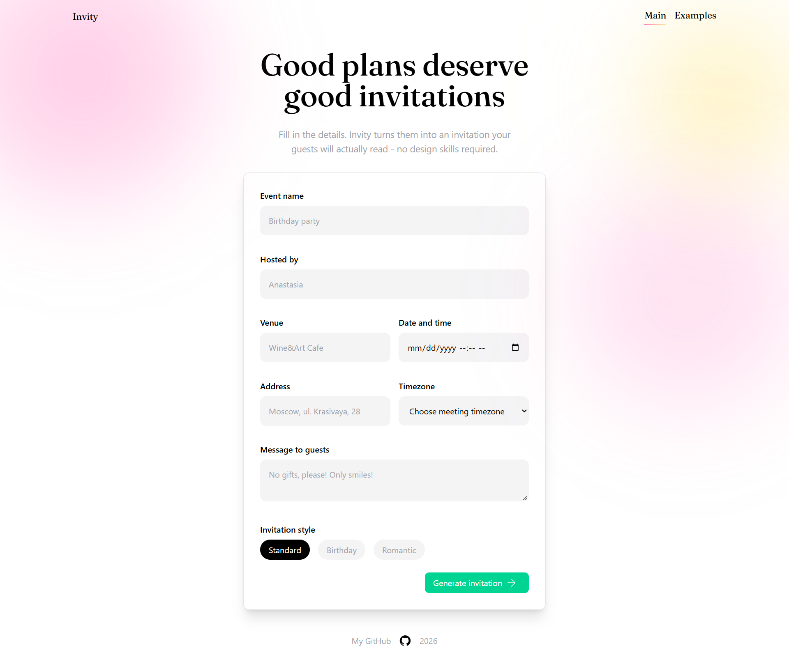
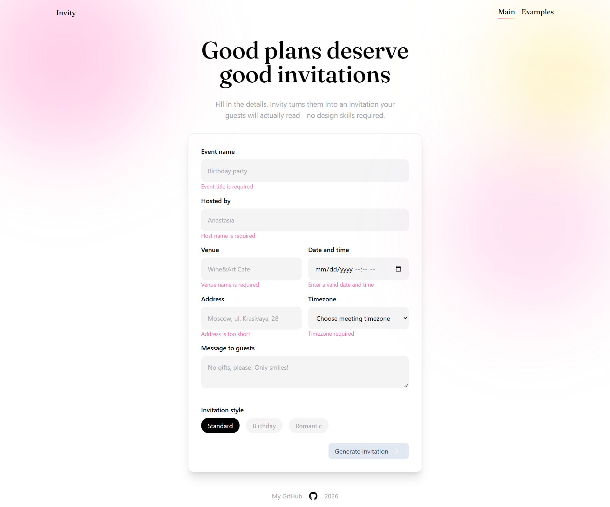
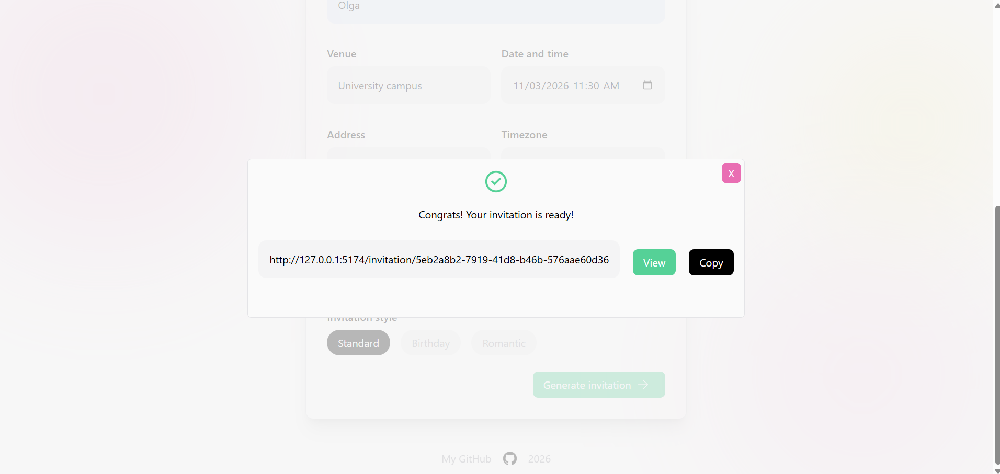
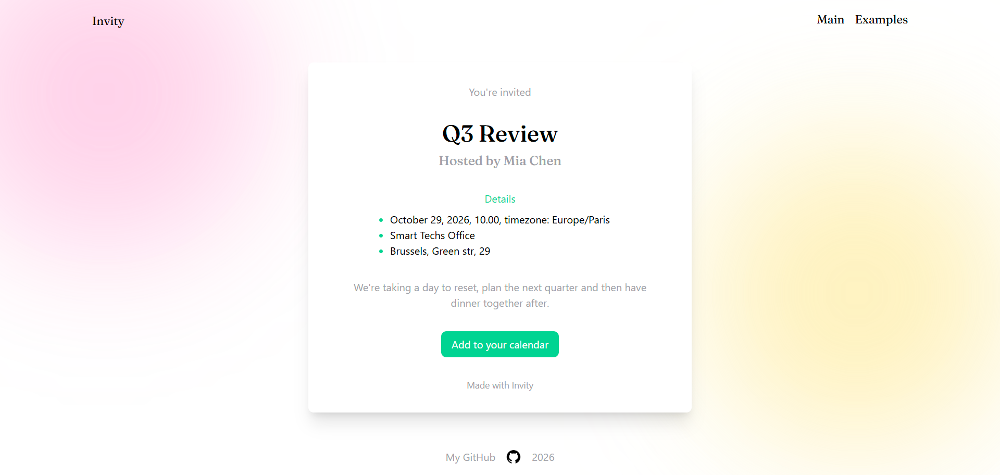
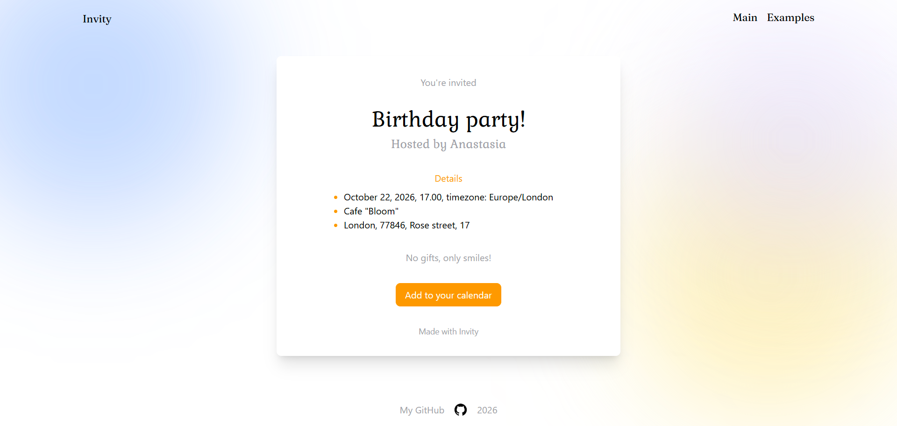
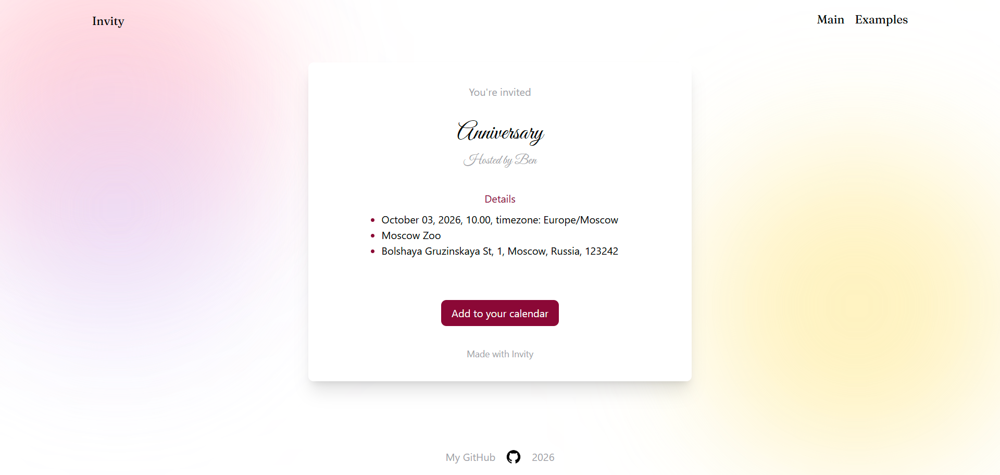
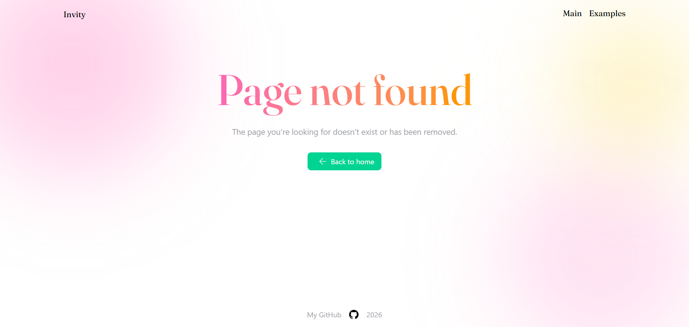

# Invity

This is a React app to create smart invitations

## Deployment

--

## Preview









## Features

- Creation of personalized invitations using a form with client-side validation powered by Zod
- Selection of themes to personalize the invitation's appearance
- Generation of unique links to share invitations and access individual invitation pages
- Storage and retrieval of invitation data using Supabase
- Display of modal dialogs with the invitation link upon successful submission or an error message if creation fails
- Addition of invitation events to the user's calendar
- Copying invitation links to the clipboard with a single click
- Reusable components, including inputs, buttons, modals, and invitation cards
- Application-level and route-specific error handling using Error Boundaries

## Technologies used

- React
- TypeScript
- Vite
- React Router
- Tailwind
- ESLint & Prettier

## Available scripts

`npm run dev`

Starts the development server

`npm run build`

Builds the project for production, using Vite

`npm run preview`

Serves the production build locally to test it before deployment

`npm run lint`

Runs ESLint on all files to detect code issues

`npm run format:fix`

Formats all files using Prettier

## Installation

1. Clone the repository

```
git clone git@github.com:silvermockingjay/postcard.git
git checkout develop
```

2. Install the dependencies

```
npm install
```
